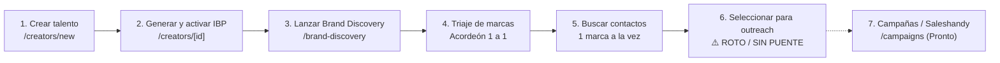
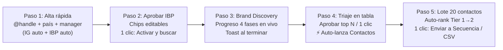

> Informe generado por Gemini (Antigravity CLI) el 2026-11-25 a partir del código de `main` y de la rama `module-mail-account`. Es un análisis automático: valida los hallazgos antes de implementarlos.

# Auditoría UX y Rediseño de Flujo — Influence Maven

> **Contexto técnico verificado en el repositorio:**
> - **Rama activa (`main`)**: contiene Dashboard, Talentos (`creators`), Búsqueda de Marcas (`brand-discovery`), Contactos (`lead-discovery`), Detalle de Lead (`leads/[id]`) y Configuración (`settings`).
> - **Nota sobre `Campañas` (`/dashboard/campaigns`)**: el enlace ya existe en [dashboard-nav.ts](file:///Users/kev/Documents/development/influencer/influencer-frontend/src/config/dashboard-nav.ts#L33-L38), pero la pantalla y el módulo de cuentas de correo (`campaigns-view.tsx`, `email-accounts/*`) viven actualmente en la rama `module-mail-account` (evaluados aquí también; en `main` ese enlace lleva a un 404).
> - **Hallazgo transversal clave**: el módulo reciente de `email-accounts` (`module-mail-account`) ya implementa un patrón SaaS B2B maduro estilo Notion/Saleshandy (toolbar con tabs de estado, filtros colapsables con chips, tabla con selección masiva, panel lateral *peek* y tira limpia de procesos recientes). En contraste, el núcleo del producto (`creators`, `brand-discovery`, `lead-discovery`) sigue estructurado como formularios largos, acordeones anidados y diagnósticos de ingeniería expuestos al usuario final.

---

## 1. Mapa del recorrido actual y puntos de fricción

| Etapa | Pantallas / Componentes | Tiempo y clics actuales | Puntos de fricción críticos |
| :--- | :--- | :--- | :--- |
| **1. Alta de talento** | [create-influencer-form.tsx](file:///Users/kev/Documents/development/influencer/influencer-frontend/src/components/influencers/create-influencer-form.tsx), [instagram-username-research-panel.tsx](file:///Users/kev/Documents/development/influencer/influencer-frontend/src/components/influencers/instagram-username-research-panel.tsx) | ~1–2 min · 8–12 interacciones | • Copy interno: *"PASO 1: talento, Instagram..."* sin mostrar cuántos pasos existen. • **Investigar Instagram** hace polling cada 2.5 s sin barra de progreso ni estimado; si termina bien, muestra jerga técnica (*"al guardar se persisten… los nichos quedan vacíos hasta la interpretación con IA"*). • El campo `Email de salida` ([talent-manager-form-fields.tsx](file:///Users/kev/Documents/development/influencer/influencer-frontend/src/components/influencers/talent-manager-form-fields.tsx#L222-L236)) es texto libre, desconectado de las cuentas conectadas en Saleshandy. • Al crear, redirige a `/creators/[id]` sin ofrecer *"Crear y generar IBP"*. |
| **2. Generación y activación de IBP** | [influencer-detail-view.tsx](file:///Users/kev/Documents/development/influencer/influencer-frontend/src/components/influencers/influencer-detail-view.tsx), [ideal-brand-profile-section.tsx](file:///Users/kev/Documents/development/influencer/influencer-frontend/src/components/influencers/ideal-brand-profile-section.tsx), [ideal-brand-profile-form.tsx](file:///Users/kev/Documents/development/influencer/influencer-frontend/src/components/influencers/ideal-brand-profile-form.tsx) | 10–20 s de espera + scroll extenso | • El bloque IBP está enterrado debajo de **4–5 cards de metadatos** (donde cada campo repite *"Procedencia: manual"* y `isPrivate`/`isVerified` se renderizan literalmente como `"true"`/`"false"` en [influencer-detail-view.tsx](file:///Users/kev/Documents/development/influencer/influencer-frontend/src/components/influencers/influencer-detail-view.tsx#L426-L448)). • Mientras genera (`PROCESSING`), solo aparece un párrafo gris sin spinner ni indicador de avance. • Al terminar queda en **`DRAFT`** (no utilizable para buscar marcas hasta hacer clic en *"Guardar perfil"*). Nadie explica esa regla. • El formulario IBP usa **8 `<Textarea>` ("Un valor por línea")** en vez de chips editables. • **Silencio tras guardar**: al hacer clic en *"Guardar perfil"*, no hay toast de confirmación ni CTA directo a *"Buscar marcas para este talento"*. |
| **3. Lanzar Brand Discovery** | [brand-discovery-view.tsx](file:///Users/kev/Documents/development/influencer/influencer-frontend/src/components/brand-discovery/brand-discovery-view.tsx), [use-brand-discovery.ts](file:///Users/kev/Documents/development/influencer/influencer-frontend/src/hooks/use-brand-discovery.ts) | 1–6 min de espera ciega | • **Doble selección confusa**: la página apila 4 bloques verticales, incluyendo **dos listas separadas de checkboxes** de influencers (*"Influencers"* para lanzar búsqueda y *"Ver marcas"* para ver resultados). `viewInfluencerIds` inicia vacío, mostrando pantalla aparentemente vacía aunque ya existan marcas. • **Bloqueo global**: si 1 solo run está `PROCESSING`, el botón *"Buscar marcas"* se deshabilita para **todos** los influencers ([brand-discovery-view.tsx](file:///Users/kev/Documents/development/influencer/influencer-frontend/src/components/brand-discovery/brand-discovery-view.tsx#L103)). • **Cero visibilidad de fases**: el backend ejecuta 4 etapas (Plan IA → SERP Bright Data → Score por lotes → Deep Research), pero en UI solo se ve el badge estático `"En curso"`. • **Ruido y errores crudos en "Búsquedas recientes"**: se muestran textos técnicos como `"PLAN_SEARCH wait failed: Timed out after 120000ms..."`, `"SERP hits: X · tras filtros: Y"`, badge `"mastra"` y queries crudas, sin botón de **Reintentar** ni forma de archivar fallos antiguos. |
| **4. Revisión y triaje de marcas** | [brand-candidate-accordion.tsx](file:///Users/kev/Documents/development/influencer/influencer-frontend/src/components/brand-discovery/brand-candidate-accordion.tsx), [brand-deep-research-panel.tsx](file:///Users/kev/Documents/development/influencer/influencer-frontend/src/components/brand-discovery/brand-deep-research-panel.tsx) | ~20–40 clics para 20 marcas | • **Acordeón dentro de acordeón** (Influencer → Marca → Deep Research → Contactos → Agencias → Personas LinkedIn): pérdida constante de contexto y scroll infinito. • **Sobrecarga de badges**: hasta **6 badges por fila** en el header del acordeón (Score, Estado, Evidencia, Programa de creadores, Base de marcas, Estado investigación). • **Sin acciones rápidas ni masivas**: para aprobar/rechazar hay que abrir el acordeón uno por uno. • **Decisiones irreversibles**: al aprobar, rechazar o posponer, los botones de estado **desaparecen** (`candidate.status === "UNDER_REVIEW"` en [brand-candidate-accordion.tsx](file:///Users/kev/Documents/development/influencer/influencer-frontend/src/components/brand-discovery/brand-candidate-accordion.tsx#L142)). No se puede deshacer un rechazo ni reactivar una marca pospuesta. |
| **5. Búsqueda de contactos** | [brand-business-contacts-panel.tsx](file:///Users/kev/Documents/development/influencer/influencer-frontend/src/components/lead-discovery/brand-business-contacts-panel.tsx), [bbc-run-status-banner.tsx](file:///Users/kev/Documents/development/influencer/influencer-frontend/src/components/lead-discovery/bbc-run-status-banner.tsx), [brand-people-leads-panel.tsx](file:///Users/kev/Documents/development/influencer/influencer-frontend/src/components/lead-discovery/brand-people-leads-panel.tsx), [agency-contacts-panel.tsx](file:///Users/kev/Documents/development/influencer/influencer-frontend/src/components/lead-discovery/agency-contacts-panel.tsx) | 2–6 min **por marca** (1 por 1) | • **Ejecución manual 1 a 1**: aunque el backend ([lead-discovery.controller.ts](file:///Users/kev/Documents/development/influencer/influencer-backend/src/lead-discovery/lead-discovery.controller.ts#L163-L166)) ya acepta `brandCandidateIds: string[]`, la UI obliga a abrir cada marca aprobada y pulsar *"Buscar contactos"* individualmente. • **Jerga de arquitectura expuesta**: *"Contact Discovery (2A + 2B)... vía Mastra + Bright Data"*, *"track 2C"*, *"pueden ser parciales u huérfanos (sin vínculo runId)"*, *"Local part con aspecto personal"*, *"FIND_AGENCY_EMAILS"*, dump de `researchTrace.steps`. • **Bug conceptual de Agencias (Track 2C)**: [agency-contacts-panel.tsx](file:///Users/kev/Documents/development/influencer/influencer-frontend/src/components/lead-discovery/agency-contacts-panel.tsx) carga agencias del **influencer**, pero está renderizado dentro de **cada marca aprobada**, duplicando exactamente la misma lista en todas las marcas. • **Polling fragmentado**: cada acordeón abierto monta su propio `useBbcDiscovery` (3 requests cada 2.5 s + 1 de agencias). Si cierras el acordeón o cambias de vista, pierdes el estado. |
| **6. Selección para outreach y Campañas** | [brand-people-leads-panel.tsx](file:///Users/kev/Documents/development/influencer/influencer-frontend/src/components/lead-discovery/brand-people-leads-panel.tsx), [lead-detail-view.tsx](file:///Users/kev/Documents/development/influencer/influencer-frontend/src/components/lead-discovery/lead-detail-view.tsx), [lead-workflow-section.tsx](file:///Users/kev/Documents/development/influencer/influencer-frontend/src/components/lead-discovery/lead-workflow-section.tsx), `campaigns-view.tsx` (`module-mail-account`) | **Flujo interrumpido** | • **Callejón sin salida en frontend**: el backend tiene `PATCH /leads/:id` y `POST /leads/:id/select`, pero **ningún componente del frontend los llama** (`ConfirmedContactsList`, `BrandPeopleLeadsPanel` y `LeadDetailView` son solo lectura, ni siquiera hay enlace a `/dashboard/leads/[id]` ni botón de copiar email en la lista). • Solo los `Lead` (personas) son seleccionables en backend (`BrandCandidate.selectedLeadId`), excluyendo los buzones comerciales de marca (`BrandBusinessContact`, Tier 2) para armar el lote de 20. • En `Campañas`, las pestañas *Secuencias* y *Prospectos* están deshabilitadas (*"Pronto"*), por lo que no existe forma de pasar contactos descubiertos a una secuencia o exportarlos en CSV. |

---

## 2. Evaluación heurística (Nielsen) por pantalla principal

### A. Navegación global, Shell y Dashboard (`/dashboard`)
Archivos: [sidebar-content.tsx](file:///Users/kev/Documents/development/influencer/influencer-frontend/src/components/layout/sidebar-content.tsx), [private-navbar.tsx](file:///Users/kev/Documents/development/influencer/influencer-frontend/src/components/layout/private-navbar.tsx), [dashboard/page.tsx](file:///Users/kev/Documents/development/influencer/influencer-frontend/src/app/%5Blocale%5D/%28private%29/dashboard/page.tsx), [dashboard-metrics-section.tsx](file:///Users/kev/Documents/development/influencer/influencer-frontend/src/components/dashboard/dashboard-metrics-section.tsx)

| Heurística | Problema detectado | Severidad |
| :--- | :--- | :---: |
| **H4. Consistencia y estándares** | El nombre del producto en sidebar y navbar es **"Influencer AI"** ([es.json](file:///Users/kev/Documents/development/influencer/influencer-frontend/src/messages/es.json#L55)), mientras que el producto y el módulo de correo usan **"Influence Maven"**. Además, se alterna entre *"Influencers"*, *"Talent Manager"* y *"Talento"*. | **Media** |
| **H5. Prevención de errores** | En `main`, el ítem *"Campañas"* ([dashboard-nav.ts](file:///Users/kev/Documents/development/influencer/influencer-frontend/src/config/dashboard-nav.ts#L34)) apunta a `/dashboard/campaigns`, ruta inexistente en `main` (404). | **Alta** |
| **H8. Diseño estético y minimalista** | `/dashboard` es una pantalla "cascarón": 2 de 4 KPIs dicen `"— Próximamente"`, hay una card punteada diciendo *"Tu espacio de trabajo está listo para crecer por módulos"*, y email + `RoleBadge` están duplicados en Sidebar y Navbar. | **Media** |
| **H1. Visibilidad del estado del sistema** | No existe un indicador global de trabajos asíncronos (IBP, Brand Discovery, Contact Discovery, Saleshandy) en la barra superior; si el usuario navega a otra sección, pierde toda visibilidad de sus procesos de 1–6 min. | **Alta** |

---

### B. Catálogo, Alta y Edición de Talentos (`/dashboard/creators`, `/new`, `/[id]/edit`)
Archivos: [influencers-table.tsx](file:///Users/kev/Documents/development/influencer/influencer-frontend/src/components/influencers/influencers-table.tsx), [influencers-table-filters.tsx](file:///Users/kev/Documents/development/influencer/influencer-frontend/src/components/influencers/influencers-table-filters.tsx), [create-influencer-form.tsx](file:///Users/kev/Documents/development/influencer/influencer-frontend/src/components/influencers/create-influencer-form.tsx), [edit-influencer-form.tsx](file:///Users/kev/Documents/development/influencer/influencer-frontend/src/components/influencers/edit-influencer-form.tsx)

| Heurística | Problema detectado | Severidad |
| :--- | :--- | :---: |
| **H2. Correspondencia con el mundo real** | [influencers-table-filters.tsx](file:///Users/kev/Documents/development/influencer/influencer-frontend/src/components/influencers/influencers-table-filters.tsx#L135-L173) expone *"Nicho legacy"*, *"El filtro de nicho TM usa contains"* y exige escribir códigos ISO de 2 letras (`ES`, `es`) a mano en vez de selectores. | **Alta** |
| **H8. Diseño estético y minimalista** | 9 campos de filtro ocupan permanentemente casi la mitad superior del viewport antes de ver la tabla, rompiendo el patrón limpio que sí tiene `EmailAccountsToolbar`. | **Media** |
| **H5. Prevención de errores** | En [influencers-table.tsx](file:///Users/kev/Documents/development/influencer/influencer-frontend/src/components/influencers/influencers-table.tsx#L296-L303), cada fila tiene un botón rojo/naranja sólido (`variant="destructive"`) de *"Eliminar"* junto a *"Ver"* y *"Editar"*, generando ruido visual y riesgo de clic accidental (debería vivir en un menú `⋯`). | **Media** |
| **H7. Flexibilidad y eficiencia** | No muestra columnas de estado del embudo (ej. *Marcas aprobadas*, *Contactos listos / 20*) ni acciones rápidas (*Generar IBP*, *Buscar marcas*) desde el catálogo. | **Media** |
| **H4. Consistencia** | En `/creators/new` el campo de Instagram está embebido en un panel punteado con `<input>` HTML nativo ([instagram-username-research-panel.tsx](file:///Users/kev/Documents/development/influencer/influencer-frontend/src/components/influencers/instagram-username-research-panel.tsx#L138-L145)), diferente al componente `Input` / `TextFormField` usado en el resto del formulario. | **Baja** |

---

### C. Ficha del Talento e IBP (`/dashboard/creators/[id]`)
Archivos: [influencer-detail-view.tsx](file:///Users/kev/Documents/development/influencer/influencer-frontend/src/components/influencers/influencer-detail-view.tsx), [ideal-brand-profile-section.tsx](file:///Users/kev/Documents/development/influencer/influencer-frontend/src/components/influencers/ideal-brand-profile-section.tsx), [ideal-brand-profile-form.tsx](file:///Users/kev/Documents/development/influencer/influencer-frontend/src/components/influencers/ideal-brand-profile-form.tsx), [talent-interpretation-panel.tsx](file:///Users/kev/Documents/development/influencer/influencer-frontend/src/components/influencers/talent-interpretation-panel.tsx)

| Heurística | Problema detectado | Severidad |
| :--- | :--- | :---: |
| **H6. Reconocimiento antes que recuerdo** | Tras generar el IBP (estado `DRAFT`), el usuario debe adivinar que tiene que guardar el formulario para pasar a `ACTIVE`, y luego ir manualmente a `/dashboard/brand-discovery` (sin enlace contextual preseleccionado) para buscar marcas. | **Alta** |
| **H1. Visibilidad del estado del sistema** | Guardar el IBP ([ideal-brand-profile-form.tsx](file:///Users/kev/Documents/development/influencer/influencer-frontend/src/components/influencers/ideal-brand-profile-form.tsx#L79-L88)) no muestra confirmación visual (*"Perfil activado · Listo para buscar marcas"*). Durante `PROCESSING` no hay spinner ni tiempo estimado (~10–20 s). | **Alta** |
| **H2. Correspondencia con el mundo real** | `isPrivate` / `isVerified` muestran `"true"` / `"false"` en inglés; `TalentInterpretationPanel` muestra rutas técnicas `(normalized.biography)`; cada campo repite `"Procedencia: manual"`. | **Media** |
| **H7. Flexibilidad y eficiencia** | Los 7 campos de lista del IBP usan `<Textarea>` (*"Un valor por línea"*) en lugar del componente [tags-input.tsx](file:///Users/kev/Documents/development/influencer/influencer-frontend/src/components/forms/tags-input.tsx) que ya existe en el proyecto. | **Media** |
| **H8. Diseño estético y minimalista** | Todo apilado verticalmente en una página muy larga (Datos + Evidencia IG + Interpretación IA + Formulario IBP de 8 campos + Marcas candidatas) sin pestañas (`Perfil` · `IBP` · `Marcas` · `Contactos`). | **Alta** |

---

### D. Búsqueda de Marcas (`/dashboard/brand-discovery`)
Archivos: [brand-discovery-view.tsx](file:///Users/kev/Documents/development/influencer/influencer-frontend/src/components/brand-discovery/brand-discovery-view.tsx), [brand-candidate-accordion.tsx](file:///Users/kev/Documents/development/influencer/influencer-frontend/src/components/brand-discovery/brand-candidate-accordion.tsx), [brand-deep-research-panel.tsx](file:///Users/kev/Documents/development/influencer/influencer-frontend/src/components/brand-discovery/brand-deep-research-panel.tsx)

| Heurística | Problema detectado | Severidad |
| :--- | :--- | :---: |
| **H1. Visibilidad del estado del sistema** | Runs de 1–6 min solo muestran badge `"En curso"` sin fase actual, sin progreso parcial y sin aviso al completar. | **Alta** |
| **H9. Ayudar a reconocer, diagnosticar y recuperarse de errores** | Los errores de backend se pintan crudos (`"PLAN_SEARCH wait failed: Timed out after 120000ms..."`), sin traducción humana ni botón de *"Reintentar"*. | **Alta** |
| **H3. Control y libertad del usuario** | **No se puede cambiar de opinión** sobre una marca una vez aprobada, rechazada o pospuesta ([brand-candidate-accordion.tsx](file:///Users/kev/Documents/development/influencer/influencer-frontend/src/components/brand-discovery/brand-candidate-accordion.tsx#L142)). Tampoco se puede cancelar una búsqueda en curso ni lanzar otra para otro talento mientras haya 1 en curso. | **Alta** |
| **H6. Reconocimiento antes que recuerdo** | Dos listas casi idénticas de checkboxes (*"Influencers"* vs *"Ver marcas"*) en la misma pantalla confunden el modelo mental; además *"Ver marcas"* arranca con 0 seleccionados, ocultando resultados existentes. | **Alta** |
| **H7. Flexibilidad y eficiencia** | Sin selección múltiple ni acciones masivas (aprobar top N, descartar batch, buscar contactos en lote). Triaje 100 % manual abriendo acordeón por acordeón. | **Alta** |
| **H8. Diseño estético y minimalista** | Sobrecarga de hasta 6 badges en el encabezado de cada marca + dump de URLs técnicas (`fetchStatus: "ok"`, `role`) en `BrandDeepResearchPanel` + `"Borrar marca"` destructivo visible en cada fila. | **Media** |

---

### E. Descubrimiento de Contactos y Detalle de Lead (`BrandBusinessContactsPanel` & `/dashboard/leads/[id]`)
Archivos: [brand-business-contacts-panel.tsx](file:///Users/kev/Documents/development/influencer/influencer-frontend/src/components/lead-discovery/brand-business-contacts-panel.tsx), [bbc-run-status-banner.tsx](file:///Users/kev/Documents/development/influencer/influencer-frontend/src/components/lead-discovery/bbc-run-status-banner.tsx), [brand-people-leads-panel.tsx](file:///Users/kev/Documents/development/influencer/influencer-frontend/src/components/lead-discovery/brand-people-leads-panel.tsx), [lead-detail-view.tsx](file:///Users/kev/Documents/development/influencer/influencer-frontend/src/components/lead-discovery/lead-detail-view.tsx)

| Heurística | Problema detectado | Severidad |
| :--- | :--- | :---: |
| **H3. Control y libertad / Flujo incompleto** | No hay botones en la UI para aprobar/descartar personas ni para **seleccionar contactos para outreach / armar el lote de 20**, ni botón rápido de copiar email en la lista principal. `/dashboard/leads/[id]` es huérfano (sin enlaces desde la app) y 100 % solo lectura. | **Alta** |
| **H2. Correspondencia con el mundo real** | Lenguaje de ingeniería en toda la pantalla: *"2A + 2B"*, *"track 2C"*, *"Mastra"*, *"Bright Data"*, *"huérfanos (sin vínculo runId)"*, *"Local part con aspecto personal"*, *"FIND_AGENCY_EMAILS"*, traza cruda de pasos SERP. | **Alta** |
| **H4. Consistencia y modelo mental** | `AgencyContactsPanel` muestra agencias del **talento** repetidas dentro del panel de **cada marca**, haciendo creer que pertenecen a esa marca. | **Alta** |
| **H7. Flexibilidad y eficiencia** | Lanzar búsqueda de contactos marca por marca con esperas de 2–6 min cada una hace inviable armar un lote de 20 contactos en una sesión fluida. | **Alta** |
| **H1. Visibilidad del estado del sistema** | No hay contador de progreso hacia la meta (*"12 / 20 contactos listos para outreach — 7 Tier 1, 5 Tier 2"*). | **Media** |

---

### F. Campañas / Cuentas de Correo (`module-mail-account`) y Configuración (`/dashboard/settings`)
Archivos: `campaigns-view.tsx`, `email-accounts/*` (`module-mail-account`), [settings/page.tsx](file:///Users/kev/Documents/development/influencer/influencer-frontend/src/app/%5Blocale%5D/%28private%29/dashboard/settings/page.tsx)

| Heurística | Problema detectado | Severidad |
| :--- | :--- | :---: |
| **H4. Consistencia** | `EmailAccountsView` usa un nivel de pulido (tabs con conteo, dropdown de filtros con chips, *Sheet* lateral de detalle, edición masiva) muy superior al resto de la app, generando sensación de dos productos distintos. | **Media** |
| **H2 / H8. Ruido técnico en Settings** | [settings/page.tsx](file:///Users/kev/Documents/development/influencer/influencer-frontend/src/app/%5Blocale%5D/%28private%29/dashboard/settings/page.tsx#L36) muestra `UnlockerDiagnosticsPanel` (*"Sonda ADMIN local... NODE_ENV distinto de production"*) a todos los usuarios en el menú principal de Configuración, además de 3 prompts solo-lectura para usuarios `USER`. | **Media** |
| **H10. Ayuda y documentación** | En `CampaignsView`, *Secuencias* y *Prospectos* aparecen deshabilitados solo con el badge `"Pronto"` sin explicar cómo enviar mientras tanto (ej. exportar CSV para Saleshandy). | **Baja** |

---

## 3. Propuestas de mejora priorizadas (Impacto vs. Esfuerzo)

### A. Quick Wins (Alto impacto · Bajo esfuerzo — 1 a 2 semanas)

1. **Humanizar textos y ocultar diagnósticos internos por defecto**
   - Limpiar [es.json](file:///Users/kev/Documents/development/influencer/influencer-frontend/src/messages/es.json): eliminar *"Mastra"*, *"Bright Data"*, *"2A/2B/2C"*, *"huérfanos (sin vínculo runId)"*, *"Local part"*, *"Nicho legacy"*, *"PASO 1"*.
   - Unificar marca a **"Influence Maven"** y vocabulario a **"Talentos"** (no mezclar *Influencers / Creadores / Talentos*).
   - Mover `ResearchTraceBlock`, `serpHits/queries`, `Procedencia` y `BrandDeepResearchPanel.pages` dentro de un colapsable discreto *"Ver detalles técnicos"* (o solo visible para `ADMIN`).
   - Ocultar `UnlockerDiagnosticsPanel` en [settings/page.tsx](file:///Users/kev/Documents/development/influencer/influencer-frontend/src/app/%5Blocale%5D/%28private%29/dashboard/settings/page.tsx) para rol `USER` y en producción; mover los prompts a una pestaña *"Avanzado (Admin)"*.
   - Formatear `isPrivate` / `isVerified` como *"Sí / No"* en [influencer-detail-view.tsx](file:///Users/kev/Documents/development/influencer/influencer-frontend/src/components/influencers/influencer-detail-view.tsx#L426-L448).

2. **Mensajes de error humanos + botón "Reintentar"**
   - Mapear códigos/patrones de error del backend en un helper central (`mapDiscoveryError(errorMessage)`):
     - `PLAN_SEARCH wait failed` / `Timed out` → *"La IA tardó más de lo esperado en planificar la búsqueda. Puedes reintentar sin perder tus marcas anteriores."* + botón **[Reintentar]**.
     - `NO_SERP_HITS` → *"No encontramos marcas nuevas con los criterios actuales del IBP. Prueba ampliar sectores o mercados."* + enlace **[Ajustar IBP]**.
     - Fallos de proveedor → *"El buscador externo tuvo una interrupción temporal."* + botón **[Reintentar]**.
   - Permitir descartar/filtrar runs `FAILED` en *"Búsquedas recientes"* (y mostrar por defecto solo los últimos 5 o los activos).

3. **Desbloquear acciones que el backend YA soporta**
   - **Permitir revertir estado de marca** en [brand-candidate-accordion.tsx](file:///Users/kev/Documents/development/influencer/influencer-frontend/src/components/brand-discovery/brand-candidate-accordion.tsx): mostrar selector de estado (`En revisión` / `Aprobada` / `Pospuesta` / `Rechazada`) siempre disponible en lugar de ocultar botones cuando ya no está en `UNDER_REVIEW`.
   - **Conectar selección de contactos y acciones de lead** en [brand-people-leads-panel.tsx](file:///Users/kev/Documents/development/influencer/influencer-frontend/src/components/lead-discovery/brand-people-leads-panel.tsx) y [brand-business-contacts-panel.tsx](file:///Users/kev/Documents/development/influencer/influencer-frontend/src/components/lead-discovery/brand-business-contacts-panel.tsx): botón *"Seleccionar para outreach"*, *"Copiar email"* (reutilizando `useCopyToClipboard`) y enlace al detalle del lead.
   - **Búsqueda de contactos en lote**: añadir botón *"Buscar contactos en todas las marcas aprobadas (N)"* que llame al endpoint existente `POST /lead-discovery/search` con `brandCandidateIds: [...]`.
   - **Desbloquear búsquedas por influencer**: en [brand-discovery-view.tsx](file:///Users/kev/Documents/development/influencer/influencer-frontend/src/components/brand-discovery/brand-discovery-view.tsx#L103), deshabilitar solo los influencers que ya tienen un run `PROCESSING`, no el botón global.

4. **Guiar el siguiente paso (CTAs y feedback inmediato)**
   - Al guardar el IBP (`DRAFT → ACTIVE`), mostrar un banner de éxito con CTA primario: **[Buscar marcas para este talento →]** enlazando a `/dashboard/brand-discovery?influencerId=...` (preseleccionado automáticamente).
   - En `/dashboard/creators/[id]`, mostrar un **stepper compacto de 4 pasos** en el header (`1. Perfil` → `2. IBP` → `3. Marcas` → `4. Contactos (X/20)`) con el siguiente CTA principal siempre visible.
   - Mergear `module-mail-account` (o esconder el enlace `/dashboard/campaigns` en `main` hasta que exista la ruta).

5. **Accesibilidad y móvil (Quick wins inmediatos)**
   - Reemplazar botones destructivos repetidos en tablas/listas por un menú `DropdownMenu` (`⋯`) con diálogo de confirmación accesible (`aria-modal`, foco atrapado).
   - Cambiar `<select>` nativos en filtros/formularios por componentes accesibles o asegurar contraste y foco visible consistente; en tablas, añadir `overflow-x-auto` con vista compacta en móvil (`< 768px`) y botones con altura mínima táctil de 36–40 px.
   - Añadir `aria-busy`, `aria-live="polite"` con spinner real (`Loader2`) y barra de progreso (`role="progressbar"`) en estados `PROCESSING`.
   - Reducir los badges por fila de marca de 6 a **máximo 3** (Score con color semántico, Estado, y 1 señal principal como *Programa de creadores*; el resto va dentro del detalle).

---

### B. Proyectos estratégicos (Alto impacto · Esfuerzo medio-alto — 3 a 6 semanas)

1. **Rediseñar Brand & Contact Discovery al estándar Notion/Saleshandy (como `EmailAccountsView`)**
   - **Eliminar los acordeones anidados y la doble lista de checkboxes.**
   - Adoptar un **Workspace por Talento** (pestañas en `/dashboard/creators/[id]` o selector superior de talento en `/dashboard/brand-discovery` con vista de tabla + panel lateral *Peek Sheet* a la derecha, igual que `EmailAccountPeek`):
     - **Tabla de marcas** con columnas escaneables: Checkbox | Marca + dominio | Score (0–100) | Señales (Programa creadores / Base conocida) | Estado (pill clickeable) | Contactos encontrados (ej. `2 Tier 1 · 1 Tier 2`) | Acciones rápidas (`✓` Aprobar · `✕` Rechazar · `Ver detalle`).
     - **Barra flotante de acciones masivas** al marcar filas: `Aprobar (N)` · `Rechazar (N)` · `Buscar contactos (N)` · `Exportar CSV`.
     - **Panel lateral (*Peek Drawer*)** al hacer clic en una marca: pestañas limpias `Resumen & Fit` | `Contactos (Tier 1 / 2 / 3)` | `Evidencia`.
   - Sacar `AgencyContactsPanel` de las marcas y moverlo a su propia pestaña/sección a nivel de **Talento** (*"Agencias del talento"*).

2. **Progreso visible por fases + Bandeja global de notificaciones/jobs**
   - Añadir un componente global **Activity / Jobs Center** en [private-navbar.tsx](file:///Users/kev/Documents/development/influencer/influencer-frontend/src/components/layout/private-navbar.tsx) (icono con badge animado cuando hay jobs corriendo): muestra en tiempo real los jobs de IBP, Brand Discovery y Contact Discovery con barra de progreso por fase (ej. *"Buscando marcas para Laura · Fase 3/4: Evaluando 18 marcas · ~1 min restante"*).
   - Al terminar un job (éxito o error), disparar un **toast persistente accionable** (*"14 marcas encontradas para Laura · [Revisar ahora]"*) y notificación opcional del navegador (`Notification API`) si la pestaña está en segundo plano.

3. **Consistencia en Catálogo de Talentos y Ficha**
   - Migrar [influencers-table-filters.tsx](file:///Users/kev/Documents/development/influencer/influencer-frontend/src/components/influencers/influencers-table-filters.tsx) al patrón de `EmailAccountsToolbar`: pestañas rápidas de estado (`Todos`, `Sin IBP`, `IBP activo`, `Listos para outreach`), buscador + botón `Filtros` en popover + chips removibles.
   - Reemplazar las 8 `<Textarea>` de [ideal-brand-profile-form.tsx](file:///Users/kev/Documents/development/influencer/influencer-frontend/src/components/influencers/ideal-brand-profile-form.tsx) por `TagsInput` (chips con autocompletado/sugerencias) y organizar `/creators/[id]` en **4 pestañas**: `Resumen`, `Perfil Ideal (IBP)`, `Marcas (N)` y `Lote de Outreach (X/20)`.
   - Conectar `Email de salida` del talento con un selector de cuentas conectadas en Saleshandy (`useEmailAccountsList`).

4. **Vista "Lote de Outreach (Meta: 20 contactos)" + Puente a Campañas / Exportación**
   - Crear una vista consolidada por talento que junte todos los contactos de sus marcas aprobadas, ordenados por Tier (`Tier 1 Verificados` → `Tier 2 Buzón de partnerships/marketing` → `Agencias accionables`), con contador visible **`16 / 20 listos`**, dedupe por dominio, edición rápida del contacto elegido por marca y botón final:
     - **[Exportar CSV para Saleshandy]** (entregable inmediato mientras llegan Secuencias)
     - **[Añadir a Secuencia de Campaña]** (cuando se habilite la pestaña *Secuencias*).

5. **Dashboard accionable (`/dashboard`)**
   - Reemplazar placeholders por un **centro de comando diario del manager**: KPIs reales (Talentos activos, Marcas por revisar, Contactos Tier 1/2 listos, Cuentas de correo conectadas/desconectadas) + lista *"Requiere tu atención"* (IBPs en borrador, marcas pendientes de triaje, búsquedas fallidas para reintentar) + botón **[+ Nuevo talento]**.

---

## 4. Flujo ideal propuesto: de "Talento nuevo" a "Lote de 20 contactos listos"

### Comparativa de fricción

| Dimensión | Flujo actual | Flujo ideal propuesto |
| :--- | :--- | :--- |
| **Clics totales** | ~65–90 clics (alta + IG + generar IBP + guardar IBP + navegar + seleccionar 2 veces + abrir 20 acordeones + aprobar 1 a 1 + lanzar contactos 1 a 1 + seleccionar) | **~10–15 clics** |
| **Esperas bloqueantes activas** | 4 esperas secuenciales mirando pantallas estáticas (IG + IBP + Brand Discovery + 10–20 runs manuales de Contact Discovery) | **1 revisión breve** (~20 s IBP) + trabajo paralelo con notificación al terminar |
| **Pantallas visitadas** | 5+ rutas desconectadas | **1 workspace unificado por talento** + modal/sheet de envío a campaña |

### Recorrido paso a paso

1. **Paso 1 — Alta inteligente (1 pantalla, ~30 s)**
   - El manager introduce `@instagram` (o nombre), país, manager (preseleccionado con el usuario actual) y opcionalmente cuenta remitente de Saleshandy.
   - Al escribir el `@handle`, se dispara la consulta de Instagram con preview inline (avatar, seguidores, bio) sin bloquear el resto del formulario.
   - Botón primario: **[Crear talento y generar IBP]** (por defecto) y secundario *"Solo crear"*.
2. **Paso 2 — Revisión rápida de IBP (1 clic, ~15 s)**
   - Abre el workspace del talento directamente en la pestaña **IBP**, con skeleton animado y barra de progreso (~15 s).
   - Al terminar, muestra los criterios en **chips editables** (no textareas) y un CTA destacado: **[Activar IBP y buscar 20 marcas]** (combina guardar `ACTIVE` + encolar Brand Discovery en un solo clic).
3. **Paso 3 — Brand Discovery no bloqueante (en segundo plano, 1–4 min)**
   - La pestaña **Marcas** (y el *Jobs Center* del header) muestra progreso en vivo:
     - `1/4 Planificando búsquedas` → `2/4 Buscando marcas en web` → `3/4 Evaluando afinidad (18 marcas)` → `4/4 Investigando marcas (12/20)`.
   - **Streaming progresivo**: conforme pasan las marcas por scoring, pueden aparecer en tabla con estado *"Investigando..."* mientras se enriquece su *Deep Research* en segundo plano.
   - El manager puede atender otro talento; al completar, recibe un toast: *"20 marcas listas para Laura · [Revisar]"*.
4. **Paso 4 — Triaje ultrarrápido con auto-descubrimiento de contactos (1–2 min, ~5 clics)**
   - Tabla estilo Notion/Airtable ordenada por `Score` descendente (resaltando *Programa de creadores* y *Base conocida*), con **atajos de teclado** (`J`/`K` mover, `A` aprobar, `X` rechazar, `Espacio` abrir *Peek*).
   - Botón de acción masiva: **[Aprobar seleccionadas (15)]**.
   - **Toggle activado por defecto: `⚡ Buscar contactos automáticamente al aprobar`** → En cuanto el manager aprueba una marca (o un lote de 15–20), el backend encola inmediatamente `contact-discovery` para esas marcas con concurrencia en paralelo, mientras el manager sigue revisando el resto.
5. **Paso 5 — Lote de 20 contactos listo para secuencia (1–2 clics)**
   - Al pasar a la pestaña **Contactos / Lote de Outreach**, el sistema ya preseleccionó automáticamente el **mejor contacto por marca aprobada** (regla determinística: 1.º `Tier 1` verificado Saleshandy → 2.º `Tier 2` buzón partnerships/creators → 3.º `Tier 2` marketing/prensa), mostrando barra **`18 / 20 contactos listos`**.
   - El manager solo cambia excepciones en un desplegable por fila (ej. elegir otro contacto de la misma marca) o marca 2 marcas más si falta cupo.
   - Botón final: **[Enviar lote (20) a Secuencia]** (eligiendo secuencia + cuenta remitente de Saleshandy) o **[Exportar CSV]**.

### Qué cambiaría en el backend (`influencer-backend`) para soportarlo

| Capacidad necesaria | Estado actual en backend | Cambio concreto requerido |
| :--- | :--- | :--- |
| **1. Progreso granular por fase** | `BrandDiscoveryRun` y `LeadDiscoveryRun` solo pasan de `PROCESSING` a `COMPLETED`/`FAILED` al final ([brand-discovery.service.ts](file:///Users/kev/Documents/development/influencer/influencer-backend/src/brand-discovery/brand-discovery.service.ts#L786-L792)). | Añadir columnas `stage` (enum: `PLANNING`, `SEARCHING`, `SCORING`, `ENRICHING`, `EMAILS_2A`, `PEOPLE_2B`, `SALESHANDY`, `AGENCIES_2C`), `progressPct` (0–100) y `stageDetail` (JSON ligero) en `BrandDiscoveryRun` y `LeadDiscoveryRun`, actualizadas en cada hito del orquestador (y `job.updateProgress()` en BullMQ). |
| **2. Eventos en tiempo real (SSE)** | Polling múltiple cada 2.5–3 s desde 4 hooks distintos (`useIbpPolling`, `useInstagramResearchPolling`, `useBrandDiscovery`, `useBbcDiscovery`). | Exponer un único endpoint **SSE** (`GET /v1/events/jobs` usando `@Sse()` de NestJS + Redis Pub/Sub) que emita eventos `ibp.updated`, `brand_discovery.progress`, `brand_discovery.completed`, `contact_discovery.progress`, `contact_discovery.completed`. Reduce carga de polling y habilita el *Jobs Center* global y toasts instantáneos. |
| **3. Errores tipados y reintento** | `BrandDiscoveryRun.errorMessage` guarda `error.message` crudo ([brand-discovery.service.ts](file:///Users/kev/Documents/development/influencer/influencer-backend/src/brand-discovery/brand-discovery.service.ts#L734-L735)). | Persistir `errorCode` tipado (`AI_PLAN_TIMEOUT`, `AI_SCORE_TIMEOUT`, `SERP_PROVIDER_ERROR`, `NO_SERP_HITS`, etc.) junto al mensaje técnico para logs, y añadir `POST /v1/brand-discovery/runs/:id/retry` y `POST /v1/lead-discovery/runs/:id/retry`. |
| **4. Auto-disparo y acciones en lote** | `PATCH /brand-discovery/candidates/:id` es unitario y no dispara contactos ([brand-discovery.controller.ts](file:///Users/kev/Documents/development/influencer/influencer-backend/src/brand-discovery/brand-discovery.controller.ts#L84-L90)). | • Crear `PATCH /v1/brand-discovery/candidates/batch` (`{ ids, status, autoDiscoverContacts?: boolean }`). • Cuando `status === 'APPROVED'` y `autoDiscoverContacts: true`, encolar automáticamente en `QUEUES.CONTACT_DISCOVERY` (idempotente si ya existe un run `PROCESSING` o `COMPLETED` reciente). • Añadir `POST /v1/influencers/:id/ibp/activate-and-search` (o flag `autoSearchBrands` en `PUT /ibp`). |
| **5. Desacoplar Track 2C (Agencias) y acelerar entrega de contactos** | En [contact-discovery-worker.options.ts](file:///Users/kev/Documents/development/influencer/influencer-backend/src/contact-discovery/contact-discovery-worker.options.ts#L57-L64), `2A + 2B + Saleshandy + 2C (agencias)` corren en el mismo job (budget hasta 4440 s), y 2C pertenece al **influencer**, no a cada marca. | • Separar **Track 2C (Agencias)** a su propio job por `influencerId` (ejecutado 1 vez por talento, no N veces por cada marca aprobada). • En `contact-discovery`, ejecutar **Saleshandy Domain Lookup** en paralelo con 2A (`FIND_BRAND_EMAILS`) y persistir contactos incrementalmente (no solo al final), para que los Tier 1 aparezcan en < 30–60 s. • Subir concurrencia controlada o usar colas con prioridad (`priority`) para lotes activos. |
| **6. Selección unificada para el lote de 20** | `BrandCandidate.selectedLeadId` solo apunta a `Lead` ([lead-discovery.controller.ts](file:///Users/kev/Documents/development/influencer/influencer-backend/src/lead-discovery/lead-discovery.controller.ts#L215-L230)), dejando fuera `BrandBusinessContact` (Tier 2). | Soportar selección polimórfica o tabla `OutreachBatchItem` / `SelectedBrandContact` que acepte tanto `leadId` (Tier 1) como `brandBusinessContactId` (Tier 2) o `agencyContactId`, con endpoint `GET /v1/influencers/:id/outreach-batch` (auto-rankeado por Tier) + `GET .../export.csv` y futuro `POST .../push-to-saleshandy`. |
| **7. Vinculación de cuenta remitente** | `Influencer.outgoingEmail` es un string libre. | Añadir `saleshandyEmailAccountId` opcional en `Influencer` (o resolverlo desde el módulo `email-accounts`) para validar que la cuenta remitente del talento esté `CONNECTED` antes de lanzar outreach. |

---

## 5. Métricas UX para validar las mejoras

Instrumentar con analítica de producto (PostHog / Mixpanel / eventos de telemetría en frontend + timestamps de backend):

| Categoría | Métrica | Cómo medirla | Línea base estimada (hoy) | Objetivo post-rediseño |
| :--- | :--- | :--- | :---: | :---: |
| **Velocidad / Eficiencia** | **Time-to-Batch-20 (TTB20)** | Tiempo desde creación del talento hasta tener 20 contactos seleccionados/exportados | 45–90 min (con mucha espera manual) | **< 12 min** (y < 3 min de trabajo activo del manager) |
| **Fricción de interacción** | **Clics por lote de 20** | Conteo de clics desde `/creators/new` hasta completar el lote | ~65–90 clics | **≤ 18 clics** |
| **Activación del embudo** | **Tasa de conversión por etapa** | `% Talentos → IBP ACTIVE → ≥1 Brand Run → ≥10 Marcas aprobadas → Lote 20 completo` | Caída alta en `DRAFT→ACTIVE` y en `Aprobada→Contactos` | **> 85 %** en `IBP → Brand Discovery` y **> 80 %** en `Aprobada → Contactos` |
| **Fiabilidad percibida** | **Tasa de recuperación de errores** | `% de runs FAILED que el usuario reintenta con éxito en < 5 min` vs abandono de sesión | Muy baja (errores técnicos sin botón Reintentar) | **> 70 %** de recuperación activa; **< 5 %** de soporte por dudas de error |
| **Adopción de productividad** | **Uso de acciones masivas y auto-contactos** | `% de marcas aprobadas en lote` y `% de Contact Discovery disparados automáticamente` | 0 % | **> 60 %** triaje masivo; **> 80 %** auto-disparo de contactos |
| **Esperas y abandono** | **Abandono durante jobs largos** | `% de sesiones que cierran pestaña mientras un run está `PROCESSING` sin volver en 24 h` | Alto (esperas ciegas sin notificación) | Reducción **≥ 50 %** gracias a progreso por fases + notificaciones |
| **Calidad UX percibida** | **SEQ (Single Ease Question) y SUS** | Micro-encuesta 1–7 tras completar el primer lote de 20 (*"¿Qué tan fácil fue armar tu lote de contactos?"*) | — (establecer baseline antes del cambio) | **SEQ ≥ 5.8 / 7** · **SUS ≥ 78** |

---

### Orden sugerido de ejecución (roadmap práctico)
1. **Sprint 1 (Quick Wins)**: humanizar copy/errores + botón *Reintentar*, permitir cambiar estado de marcas ya revisadas, habilitar selección de contactos + copiar email + búsqueda de contactos en lote, CTA post-IBP y unificar `module-mail-account` en `main`.
2. **Sprint 2 (Backend habilitador)**: `stage`/`progressPct` en runs, endpoint SSE `/v1/events/jobs`, `batch` de aprobación con `autoDiscoverContacts`, desacoplar Track 2C por talento y modelo unificado de lote de outreach (Tier 1 + Tier 2).
3. **Sprint 3 (Workspace Notion/Saleshandy)**: reemplazar los acordeones de `BrandDiscoveryView` por tabla + *Peek Drawer* + barra masiva + *Jobs Center* global en navbar + pestaña *Lote de 20* con export CSV / puente directo a *Campañas → Secuencias*.
